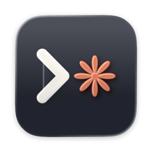

  

<h1 align="center">Bench</h1>

  <strong>A home for your Claude Code sessions.</strong> 
  Run Claude in tabs, watch every change as it lands, and keep tabs on it all from your iPhone.

  <a href="https://github.com/mattbirchler/bench-releases/releases/latest"><strong>Download for Mac</strong></a>
  &nbsp;·&nbsp; Free &nbsp;·&nbsp; Apple silicon, macOS 26 or later

<!-- MAC HERO: the main window with a Claude tab working and the changes panel open -->

---

## Every project gets its own workspace

Add a project folder and Bench gives it a window of tabs: Claude Code, shells, files, and diffs, side by side. The sidebar shows each project's branch, whether Claude is working, waiting on you, or done, and how long it's been at it. Switch between projects without losing your place.

## See the changes as Claude makes them

The changes panel lists every file Claude touches, live, with additions and deletions. Click one for a full diff, or switch to Files to browse the rest of the project. Stage what you like, and see which commits your branch has that the base branch doesn't.

<!-- MAC SHOT: a diff tab with the changes panel -->

## Hand work to agents on their own branches

Start an agent with a prompt and Bench gives it a fresh git worktree, so it can't step on what you're doing. Each agent shows up under its project with its own status, its pull request, and whether checks passed. When the PR merges, Bench can clean up the worktree for you.

## Keep an eye on it from your iPhone

The Bench iPhone app connects to your Mac over your own Tailscale network. See every session at a glance, read along as Claude works, tap Allow or Deny when it asks permission, reply with a message or a photo, and review diffs from the couch.

  

The iPhone app is coming soon through TestFlight. Your code goes straight from your Mac to your phone and never through anyone's servers.

## And a lot of small things

- **One-click shortcuts.** Add your own tab shortcuts for commands you run all the time, and get a dev server button in JavaScript projects.
- **Pick up where you left off.** Resume past Claude conversations from History, and Bench brings your tabs back when it relaunches.
- **Menu bar status.** See what's working and what needs you without switching apps.
- **Previews.** Open your local dev server in a tab next to the code.
- **Other Macs.** Pair a second Mac and see its projects in the same sidebar.
- **Updates itself.** New versions download in the background and install when you quit.

## Requirements

- A Mac with Apple silicon (M1 or later). Intel Macs aren't supported.
- macOS 26 or later.
- [Claude Code](https://claude.com/product/claude-code), installed and signed in.
- git, from Apple's command line tools. Bench offers to install them if they're missing.

Optional: the [GitHub CLI](https://cli.github.com) for pull request status, and [Tailscale](https://tailscale.com/download/mac) for the iPhone app and other Macs. Bench checks for all of these the first time it opens.

## Install

1. Download the zip from the [latest release](https://github.com/mattbirchler/bench-releases/releases/latest) and open it.
2. Drag Bench into your Applications folder.
3. Open Bench and add a project folder.

Bench is signed and notarized by Apple.

## Privacy and terms

Bench is free to use, and provided as is, without warranty of any kind. It has no analytics and doesn't send your code anywhere. The only thing it fetches on its own is this repository's update feed. Claude Code talks to Anthropic as it normally does. See the [privacy policy](privacy.md) and [support](support.md) pages.

Bench is an independent app, not made by or affiliated with Anthropic. Claude and Claude Code are trademarks of Anthropic. Bench is built with Ghostty, Sparkle, and other open source projects; their licenses are in Bench > Acknowledgements.

---

Made by <a href="https://birchtree.productions">Birchtree Productions</a>

