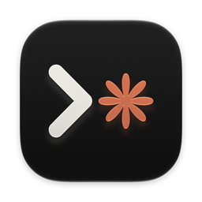
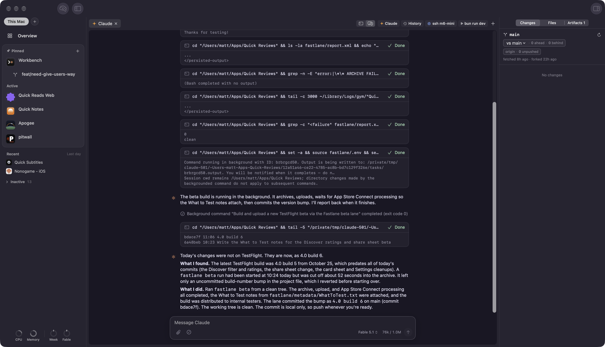
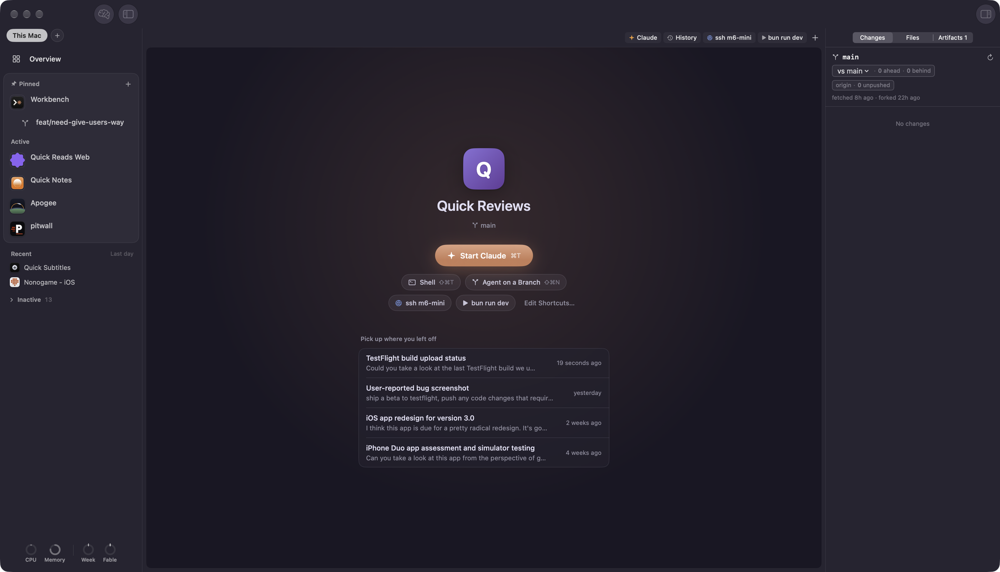
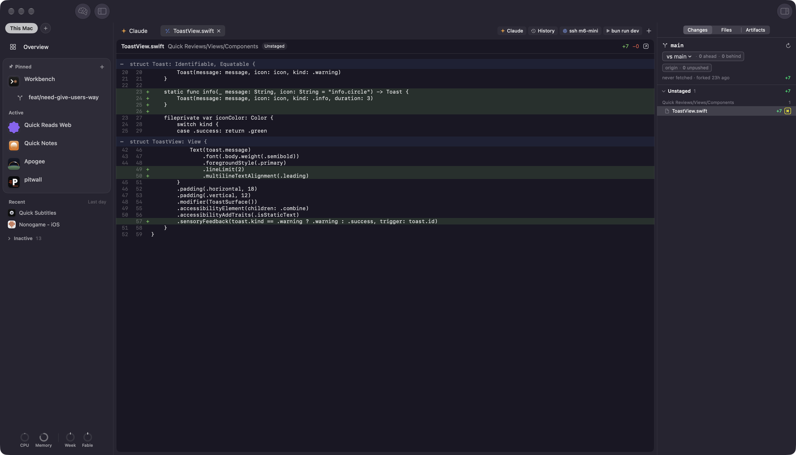
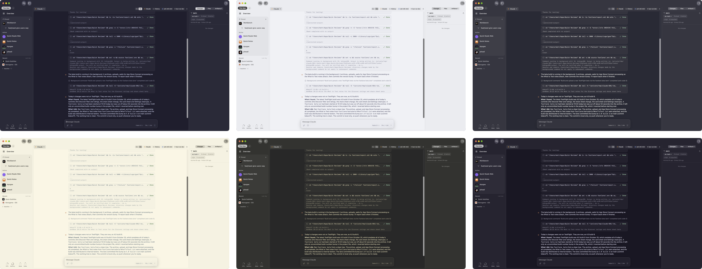
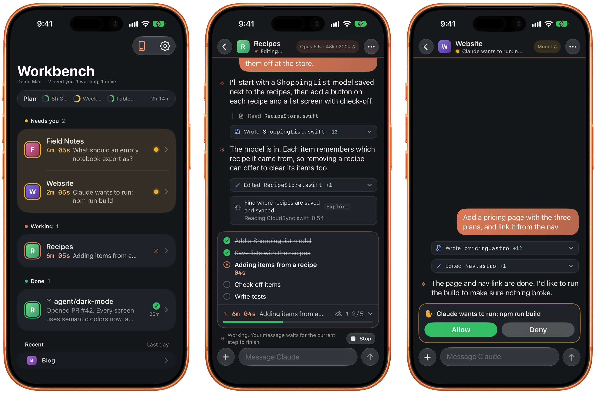
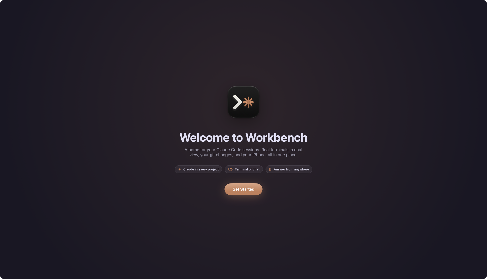

  

<h1 align="center">Workbench</h1>

  <strong>A home for your Claude Code sessions.</strong> 
  Run Claude in tabs, watch every change as it lands, and keep tabs on it all from your iPhone.

Formerly called Bench. Same app, new name.

  <a href="https://github.com/mattbirchler/bench-releases/releases/latest"><strong>Download for Mac</strong></a>
  &nbsp;·&nbsp; Free &nbsp;·&nbsp; Apple silicon, macOS 26 or later

  

---

## Terminal or chat, same session

Claude Code runs in a real terminal in every Claude tab, built on Ghostty, so it uses your font, theme, and keybindings. Press ⌥⌘T and the same session turns into a chat: edits show as diffs, commands fold their output away, and questions and permission prompts become cards with real buttons. It's still Claude Code underneath, so you can flip back any time. Pick which one new tabs open as in Settings > Claude.

The chat view has the touches you'd expect from a messaging app:

- **Your message shows the instant you send it,** and new turns glide in.
- **Claude's suggested next message** shows faintly in the empty message box. Press Right Arrow or Tab to take it.
- **Slash commands autocomplete** as you type `/`: the built-in ones, your own, the project's, and your skills.
- **Queued messages** can be edited, removed, or sent right away (Control-Return), like Ctrl+Return in the terminal.
- **Subagents get cards** that show what each one is doing right now. With the right panel hidden, the task list or the running agents stay pinned above the message box.
- **The model and context** sit in the message box, like "Opus 5.5" and "76k / 1M". Click the model to switch.
- **Compact or clear** from the / button, and Shift-Return for a new line.

## Every project gets its own workspace

Add a project folder and Workbench gives it tabs for Claude, shells, files, diffs, and previews of your dev server, side by side. The sidebar shows each project's branch, pull request, and whether Claude is working, waiting on you, or done. Rest the pointer on a project to see what Claude is doing, what it's asking, and a one-line recap of what it last finished.

**Projects sort themselves.** Pin the ones you always want on top. Projects Claude is working in, or that you used in the last few hours, sit under Active. The ones from the last day are under Recent, and the rest fold away under Inactive until you use them again. Work Claude Code remembers from outside Workbench counts too.

**Every project has a start page.** When a project has no tabs open, or you press +, you get a big Start Claude button, a shell, an agent on a new branch, your shortcuts, and your last few conversations to pick back up in one click.

  

## See the changes as Claude makes them

The changes panel lists every file Claude touches, live, grouped by folder with additions and deletions. Click one for a full diff, and leave comments on lines to send back to Claude. Switch to Files to browse the rest of the project, or Artifacts for the pages Claude has published. The branch header shows how far ahead or behind the base branch you are, and you can pick which branch to compare against.

  

## Hand work to agents on their own branches

Start an agent with a prompt and Workbench gives it a fresh git worktree on its own branch, so it can't step on what you're doing. Each agent shows up under its project with its own status, its pull request, and whether checks passed. After a pull request merges, Workbench follows the deploy on hosts like Vercel and Railway. Clean up the worktree with one click, or have Workbench do it for you once the PR merges.

**Brain Dump** (⌥⌘N, or the brain button at the top of the sidebar) starts several at once. Describe everything you want done across your projects, and Claude splits it into one task per project, each with a branch and a prompt you can edit. Nothing starts until you click Start.

## Looks like your terminal

Workbench takes on your Ghostty theme's colors for its sidebars, chat, and diffs, and switches between light and dark with your Mac. Here's the same session in Catppuccin Mocha, Catppuccin Latte, Dracula, Solarized Light, Gruvbox Dark, and Rosé Pine.

  

## Keep an eye on it from your iPhone

The Workbench iPhone app connects to your Mac over your own Tailscale network. Sessions that need you sit at the top, then the ones Claude is working on, then the ones that are done. Read along as Claude works, answer its questions, tap Allow or Deny when it asks permission, reply with a message or a photo, stop it mid-step, and review diffs from the couch. You can also start new Claude tabs and agents, run Brain Dump, browse a project's files, and run shortcuts like your dev server on the Mac.

- **Notifications for the projects you choose.** On the Mac, right-click a project and choose Send Notifications to iPhone. You'll hear when Claude needs you, when it finishes, and when checks and deploys are done.
- **A Lock Screen dashboard.** Tap the phone button at the top of your project list to put every session on your Lock Screen at once, kept up to date by your Mac.

  

The iPhone app is in beta on TestFlight and needs iOS 27. It also runs as a full iPad app.

## A welcome that sets you up

The first time you open Workbench, it checks your Mac for the tools it uses, including whether Claude Code is signed in, and offers to sign you in right there. Then it asks whether you'd like Claude tabs as a terminal or a chat, matches your theme, suggests projects from the folders you've already used Claude Code in, and pairs your iPhone. Help > Welcome to Workbench shows it again.

  

## And a lot of small things

- **Overview.** Every Claude session across every project in one grid, with the ones that need you first (⌘0). ⌘J jumps to the next session that needs you.
- **Go anywhere.** ⌘K opens a command bar for any project or action.
- **Your plan's limits.** Rings at the bottom of the sidebar show your 5-hour, weekly, and per-model limits next to your Mac's CPU and memory. They stay grey until they need your attention.
- **Usage and costs.** See what your sessions would cost at API prices, by day, model, and project (⇧⌘U).
- **One-click shortcuts.** Add tab shortcuts for commands you run all the time, and get a dev server button in JavaScript projects. Its ports show up so you can open a preview.
- **Pick up where you left off.** Resume past conversations from Past Sessions (⌘Y) or a project's start page, and Workbench brings your tabs back when it relaunches.
- **Your draft stays put.** Text in the message box is still there when you switch projects and come back.
- **Menu bar status.** See what's working and what needs you without switching apps.
- **Other Macs.** Pair a second Mac and work in its projects from the same sidebar: read and answer its sessions, start Claude tabs and agents, look at its changes, run its shortcuts, and clean up its agents.
- **Updates itself.** New versions download in the background and install when you quit. A What's New window tells you what changed.

## Requirements

- A Mac with Apple silicon (M1 or later). Intel Macs aren't supported.
- macOS 26 or later.
- [Claude Code](https://claude.com/product/claude-code), installed and signed in.
- git, from Apple's command line tools. Workbench offers to install them if they're missing.

Optional: the [GitHub CLI](https://cli.github.com) for pull request, check, and deploy status, and [Tailscale](https://tailscale.com/download/mac) for the iPhone app and other Macs. Workbench checks for all of these the first time it opens.

## Install

1. Download the zip from the [latest release](https://github.com/mattbirchler/bench-releases/releases/latest) and open it.
2. Drag Workbench into your Applications folder.
3. Open Workbench. The welcome walks you through the rest.

Workbench is signed and notarized by Apple.

## Privacy and terms

Workbench is free to use, and provided as is, without warranty of any kind. Your code and conversations go straight from your Mac to your own devices. Notifications pass through Workbench's push service on their way to Apple, encrypted so only your phone can read them; the Lock Screen dashboard isn't encrypted yet. Workbench shares anonymous usage counts, like how many agents you start, to help improve it. Turn that off with Share Anonymous Usage Data in Settings > General on the Mac, or in Settings on the iPhone. Claude Code talks to Anthropic as it normally does. The [privacy policy](privacy.md) lists everything Workbench connects to, and the [support](support.md) page covers setup and common problems.

Workbench is an independent app, not made by or affiliated with Anthropic. Claude and Claude Code are trademarks of Anthropic. Workbench is built with Ghostty, Sparkle, and other open source projects; their licenses are in Workbench > Acknowledgements.

---

Made by <a href="https://birchtree.productions">Birchtree Productions</a>

