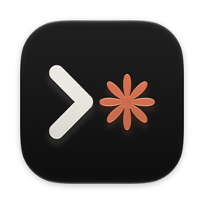
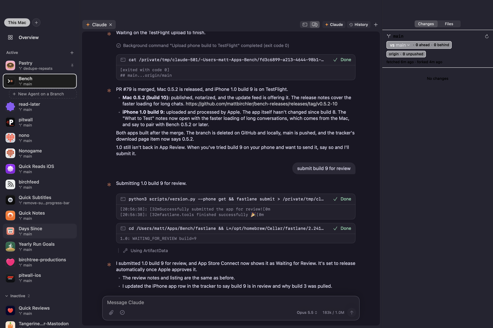
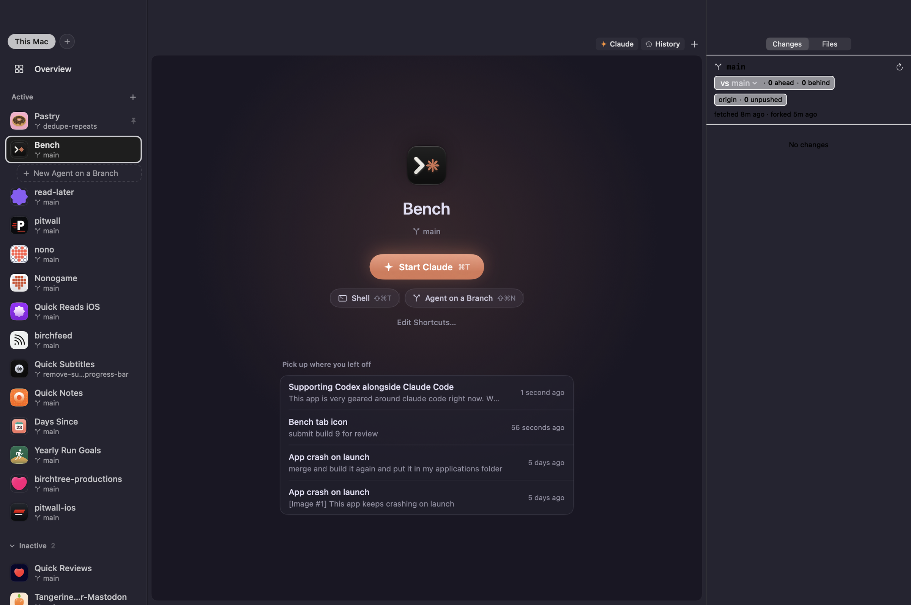
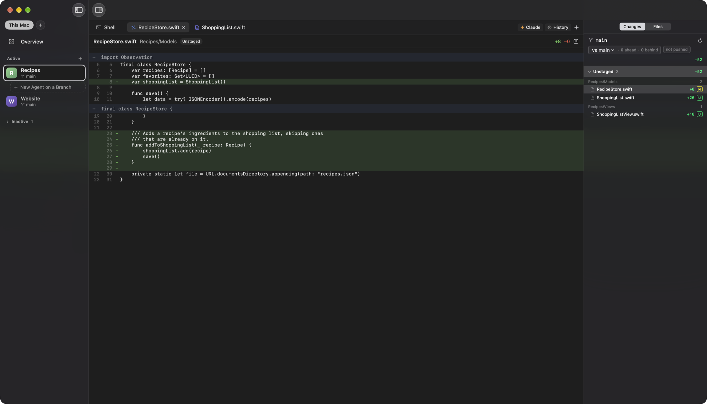
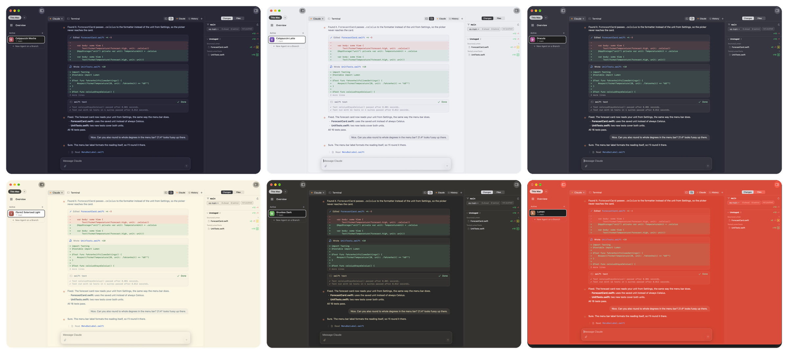
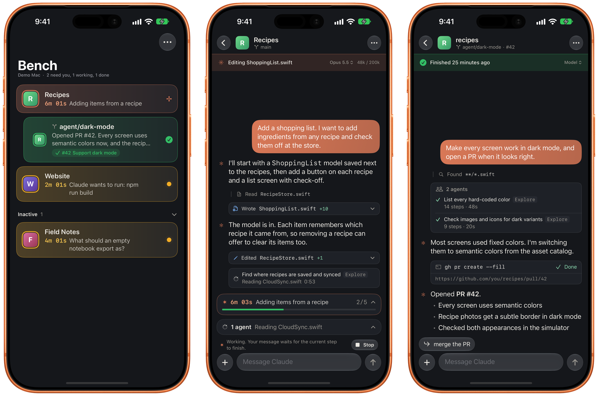
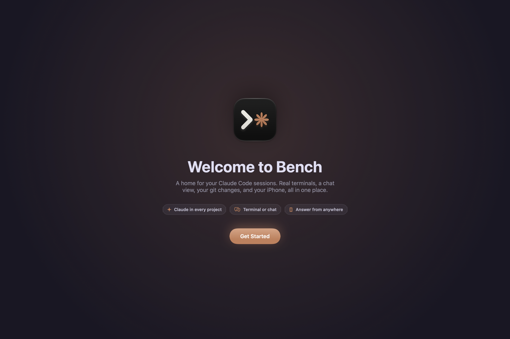

  

<h1 align="center">Bench</h1>

  <strong>A home for your Claude Code sessions.</strong> 
  Run Claude in tabs, watch every change as it lands, and keep tabs on it all from your iPhone.

  <a href="https://github.com/mattbirchler/bench-releases/releases/latest"><strong>Download for Mac</strong></a>
  &nbsp;·&nbsp; Free &nbsp;·&nbsp; Apple silicon, macOS 26 or later

  

---

## Terminal or chat, same session

Claude Code runs in a real terminal in every Claude tab, built on Ghostty, so it uses your font, theme, and keybindings. Press ⌥⌘T and the same session turns into a chat: edits show as diffs, commands fold their output away, and questions and permission prompts become cards with real buttons. It's still Claude Code underneath, so you can flip back any time. Choose which one new tabs open as in Settings.

The chat view has the touches you'd expect from a messaging app:

- **Your message shows the instant you send it,** and new turns glide in.
- **Claude's suggested next message** shows faintly in the empty message box. Press Right Arrow or Tab to take it.
- **Queued messages** can be edited, removed, or sent right away (Control-Return), like Ctrl+Return in the terminal.
- **Subagents get cards** that show what each one is doing right now, and stay pinned in the sidebar while they run.
- **The model and context** sit in the message box, like "Opus 5.5" and "183k / 1M". Click the model to switch.
- **Compact or clear** from the / menu, and Shift-Return for a new line.

## Every project gets its own workspace

Add a project folder and Bench gives it tabs for Claude, shells, files, and diffs, side by side. The sidebar shows each project's branch, pull request, and whether Claude is working, waiting on you, or done.

**Active projects sort themselves.** Projects you've worked in lately sit under Active, newest first, counting work Claude Code remembers from outside Bench too. Pin the ones you always want on top. The rest fold away under Inactive and come back as soon as you use them.

**Every project has a start page.** When a project has no tabs open, or you press +, you get a big Start Claude button, a shell, an agent, your shortcuts, and your last few conversations to pick back up in one click.

  

## See the changes as Claude makes them

The changes panel lists every file Claude touches, live, with additions and deletions. Click one for a full diff, or switch to Files to browse the rest of the project. Stage what you like, and see which commits your branch has that the base branch doesn't.

  

## Hand work to agents on their own branches

Start an agent with a prompt and Bench gives it a fresh git worktree, so it can't step on what you're doing. Each agent shows up under its project with its own status, its pull request, and whether checks passed. When the PR merges, Bench can clean up the worktree for you.

## Looks like your terminal

Bench takes on your Ghostty theme's colors for its sidebars, chat, and diffs, and goes light or dark to match. Here's the same session in Catppuccin Mocha, Catppuccin Latte, Dracula, Solarized Light, Gruvbox Dark, and Lumen.

  

## Keep an eye on it from your iPhone

The Bench iPhone app connects to your Mac over your own Tailscale network. See every session at a glance, read along as Claude works, answer its questions, tap Allow or Deny when it asks permission, reply with a message or a photo, stop it mid-step, and review diffs from the couch. A notification and a Live Activity tell you when Claude needs you or finishes.

  

The iPhone app is in beta on TestFlight. Your code goes straight from your Mac to your phone and never through anyone's servers.

## A welcome that sets you up

The first time you open Bench, it checks your Mac for the tools it uses, asks whether you'd like Claude tabs as a terminal or a chat, matches your theme, suggests projects from the folders you've already used Claude Code in, and pairs your iPhone. Help > Welcome to Bench shows it again.

  

## And a lot of small things

- **Overview.** Every Claude session across every project in one grid, with the ones that need you first.
- **One-click shortcuts.** Add your own tab shortcuts for commands you run all the time, and get a dev server button in JavaScript projects.
- **Pick up where you left off.** Resume past Claude conversations from History or a project's start page, and Bench brings your tabs back when it relaunches.
- **Your draft stays put.** Text in the message box is still there when you switch projects and come back.
- **Menu bar status.** See what's working and what needs you without switching apps.
- **Previews.** Open your local dev server in a tab next to the code.
- **Other Macs.** Pair a second Mac and see its projects, and start Claude on it, from the same sidebar.
- **Updates itself.** New versions download in the background and install when you quit.

## Requirements

- A Mac with Apple silicon (M1 or later). Intel Macs aren't supported.
- macOS 26 or later.
- [Claude Code](https://claude.com/product/claude-code), installed and signed in.
- git, from Apple's command line tools. Bench offers to install them if they're missing.

Optional: the [GitHub CLI](https://cli.github.com) for pull request status, and [Tailscale](https://tailscale.com/download/mac) for the iPhone app and other Macs. Bench checks for all of these the first time it opens.

## Install

1. Download the zip from the [latest release](https://github.com/mattbirchler/bench-releases/releases/latest) and open it.
2. Drag Bench into your Applications folder.
3. Open Bench. The welcome walks you through the rest.

Bench is signed and notarized by Apple.

## Privacy and terms

Bench is free to use, and provided as is, without warranty of any kind. It has no analytics and doesn't send your code anywhere. The only thing it fetches on its own is this repository's update feed. Claude Code talks to Anthropic as it normally does. See the [privacy policy](privacy.md) and [support](support.md) pages.

Bench is an independent app, not made by or affiliated with Anthropic. Claude and Claude Code are trademarks of Anthropic. Bench is built with Ghostty, Sparkle, and other open source projects; their licenses are in Bench > Acknowledgements.

---

Made by <a href="https://birchtree.productions">Birchtree Productions</a>

